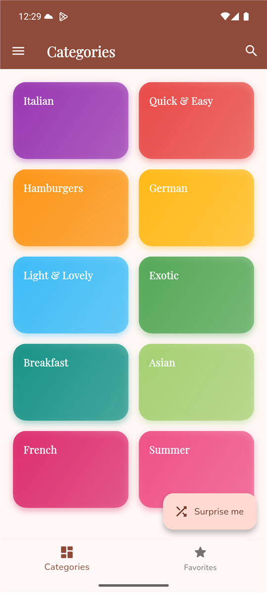
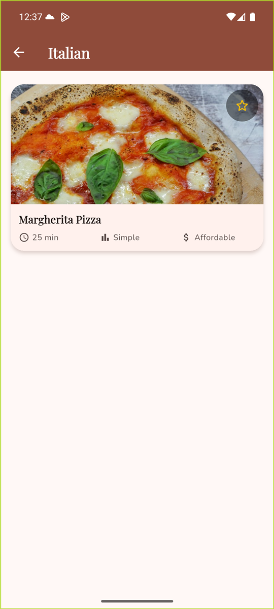
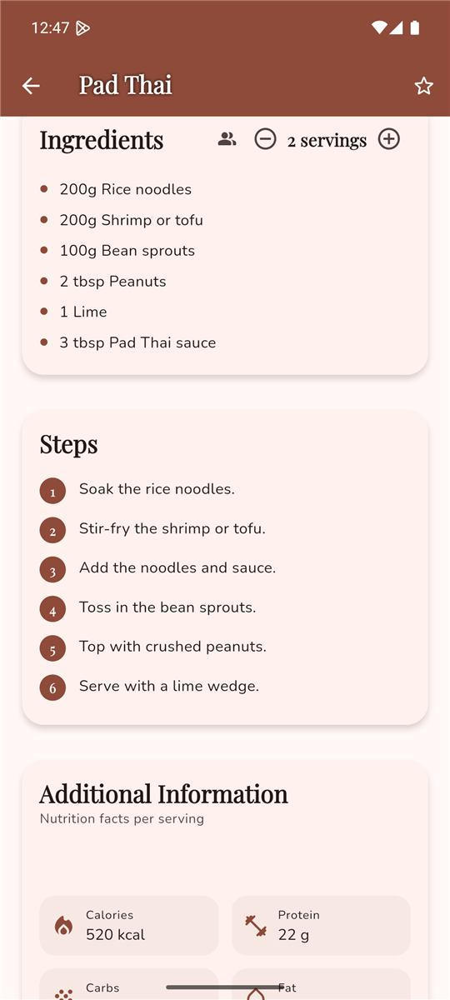
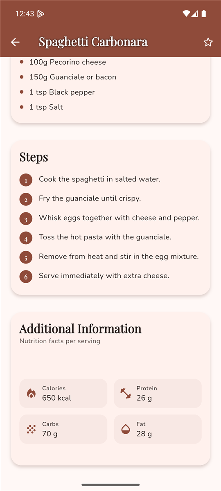
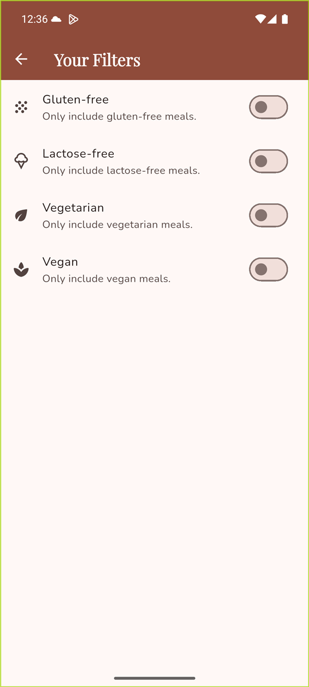
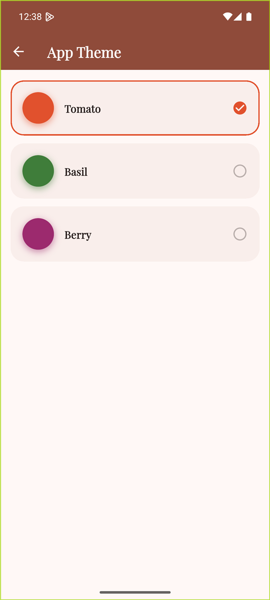

# Meals App

A Flutter app for browsing recipes by category, viewing full recipe details, filtering by diet,
and saving favorites — built for the NTNU *Mobile Applications* course (Assignment #3).

<p align="center">
  
  
  
</p>

<p align="center">
  
  
  
</p>

## Features

| Assignment requirement | How it is done |
| --- | --- |
| Browse meals grouped by category | `CategoriesScreen`: a grid of 10 predefined categories |
| View all meals in a category | `MealsScreen`, filtered by category id |
| Meal details: ingredients, steps, complexity, affordability, additional info | `MealDetailScreen`: Hero image, quick facts, ingredients, numbered steps, nutrition facts |
| Mark meals as favorites | `FavoritesProvider`, a star button on every meal card and on the detail screen |
| View and manage favorites | `FavoritesScreen`, reachable from the bottom navigation bar |
| Filter by gluten-free / lactose-free / vegetarian / vegan | `FiltersProvider` + `FiltersScreen`, applied to every meal list |
| Seamless navigation between all screens | `Navigator` + a `Drawer` (Filters, Theme) and a bottom nav bar (Categories, Favorites) |

Extras: a servings calculator that rescales ingredient quantities, full nutrition facts (calories,
protein, carbs, fat) per serving, search by meal title, a "Surprise me" random meal button, 3
selectable color themes, and animations (Hero image transitions, a staggered category grid, and
animated favorite icons).

## Data and images

Categories and meals are hardcoded in `lib/data/dummy_data.dart` (19 recipes across 10
categories), similar to the reference Udemy course. Meal photos are loaded from Unsplash over the
network (`cached_network_image` handles caching, loading and error states) instead of being
bundled as local assets, so the app needs an internet connection to show photos.

## Project structure

```
lib/
├── main.dart                        App entry point, MultiProvider + MaterialApp
├── models/
│   ├── meal.dart                    Meal, Complexity, Affordability
│   ├── category.dart                Category
│   └── nutrition.dart               NutritionFacts (calories, protein, carbs, fat)
├── data/
│   └── dummy_data.dart              Hardcoded categories and meals (with Unsplash photo URLs)
├── providers/
│   ├── favorites_provider.dart      FavoritesProvider (ChangeNotifier, persisted)
│   ├── filters_provider.dart        FiltersProvider (the 4 dietary switches)
│   └── theme_provider.dart          ThemeProvider (selected color theme, persisted)
├── theme/
│   └── app_theme.dart               Theme presets and buildAppTheme()
├── screens/
│   ├── tabs_screen.dart             Root screen: bottom nav, drawer, search, "Surprise me"
│   ├── categories_screen.dart       Category grid with a staggered entrance animation
│   ├── meals_screen.dart            Meals in one category, filtered
│   ├── meal_detail_screen.dart      Full recipe: ingredients, steps, nutrition, servings
│   ├── favorites_screen.dart        Saved favorite meals, filtered
│   ├── filters_screen.dart          The 4 dietary filter switches
│   └── theme_screen.dart            Theme picker
├── widgets/
│   ├── meal_item.dart               One meal card (image, quick facts, favorite star)
│   ├── meals_list.dart              Renders a list of meals or an empty-state message
│   ├── category_grid_item.dart      One category tile
│   ├── main_drawer.dart             Drawer with links to Filters and Theme
│   └── meal_search_delegate.dart    Full-screen search over all meal titles
└── utils/
    └── ingredient_scaler.dart       scaleIngredient(): rescales "200g Flour" for N servings
docs/screenshots/                    Screenshots used in this README
test/widget_test.dart                Widget tests
```

## How it works

**Data flow.** `dummyMeals` and `availableCategories` in `data/dummy_data.dart` are the single
source of truth; screens just filter that list differently (by category id, by favorite id, by
search text, by active dietary filters). Nothing is duplicated or copied between screens.

**State management: Provider.** Three `ChangeNotifier`s are created once in `main.dart` with
`MultiProvider` and read anywhere below with `context.watch<T>()` (rebuilds on change) or
`context.read<T>()` (fire-and-forget calls):

- `FavoritesProvider` — holds the set of favorite meal ids, exposes `toggleFavorite(meal)` and
  `isFavorite(id)`, and saves the ids with `shared_preferences` so favorites survive a restart.
- `FiltersProvider` — holds the 4 on/off dietary switches and `applyTo(meals)`, which every meal
  list (category, favorites, search) calls to filter itself. Filters are intentionally **not**
  persisted — they reset to "show everything" on next launch.
- `ThemeProvider` — holds the selected `AppThemeId` and persists it the same way.

**Main classes and functions**

- `Meal` — the data model (id, categories, title, image, ingredients, steps, duration, complexity,
  affordability, servings, nutrition, dietary flags).
- `NutritionFacts` — calories/protein/carbs/fat for one serving; shown in the "Additional
  Information" card and never changes with the servings stepper (like a real nutrition label).
- `MealDetailScreen._toggleFavorite` — calls the provider and shows a SnackBar confirmation.
- `MealDetailScreen._changeServings` — updates how many servings are selected; the ingredient list
  passes each string through `scaleIngredient()` to rescale its quantity live.
- `scaleIngredient(ingredient, factor)` — parses the leading number/unit of an ingredient string
  (e.g. `"200g Flour"`) and multiplies it by `factor`, rounding sensibly for weights vs. counts.
- `buildAppTheme(seedColor, brightness)` — builds the full Material 3 `ThemeData` (colors, fonts,
  cards, buttons) from one seed color, so every selectable theme stays visually consistent.

**Navigation.** `TabsScreen` is the app's root: a `BottomNavigationBar` switches between
`CategoriesScreen` and `FavoritesScreen`, a `Drawer` links to `FiltersScreen` and `ThemeScreen`,
and every meal card pushes `MealDetailScreen` with a `MaterialPageRoute`. A shared `Hero` tag on
the meal image makes it fly smoothly from the list into the detail screen.

## Run the app

Requirements: Flutter SDK (Dart 3.13+), an internet connection (for meal photos).

```bash
flutter pub get
flutter run
```

Run the tests and static analysis:

```bash
flutter test
flutter analyze
```

**Windows note.** If the Android build fails in `compileDebugKotlin` with "this and base files
have different roots", the project and the Pub cache are on different drives.
`android/gradle.properties` already sets `kotlin.incremental=false` to avoid this.

## Built with

- Flutter (Material 3) and Dart
- [`provider`](https://pub.dev/packages/provider) — state management
- [`shared_preferences`](https://pub.dev/packages/shared_preferences) — persisting favorites and theme
- [`cached_network_image`](https://pub.dev/packages/cached_network_image) — meal photo loading and caching
- [`google_fonts`](https://pub.dev/packages/google_fonts) — Playfair Display + Nunito
